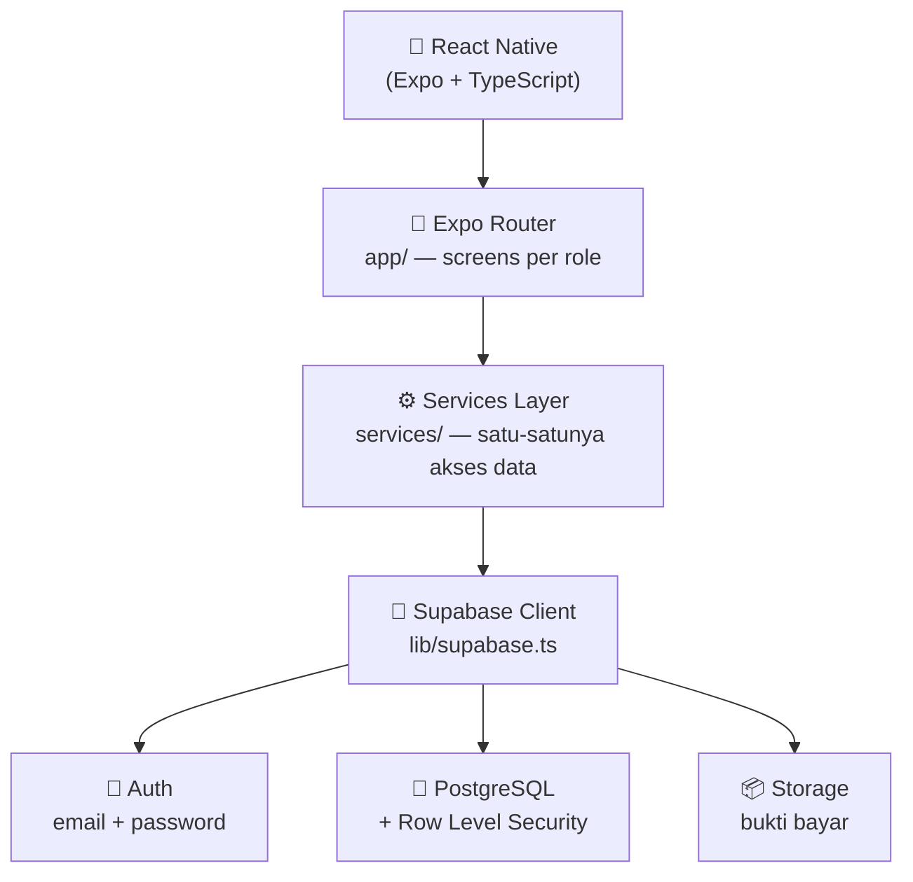
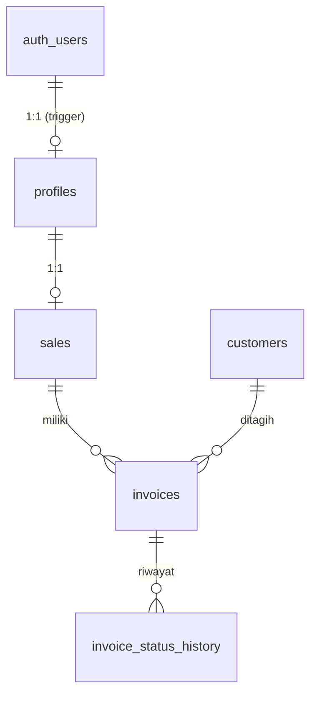

<div align="center">

# 📱 SalesCollect

**Aplikasi mobile untuk manajemen penagihan invoice sales**
*(Invoice Collection Management System)*


</div>

---

## ✨ Fitur Unggulan

| | |
| :--- | :--- |
| 🔐 **Autentikasi** | Login, register, lupa/reset password via email (Supabase Auth) |
| 👥 **Dua Role** | Admin (akses penuh) & Sales (akses terbatas) — hak akses ditegakkan oleh **RLS di database**, bukan sekadar sembunyi UI |
| 🧾 **Kelola Invoice** | Buat, lihat, edit, hapus invoice; filter status & pencarian |
| 🔄 **Alur Status** | Transisi linear `belum_ditagih → sudah_ditagih → dibayar` dengan riwayat lengkap & anti lompat status |
| 📊 **Dashboard** | Ringkasan piutang: total invoice, belum/sudah ditagih, sudah dibayar — dihitung di database |
| 📈 **Laporan** | Collection report per periode & per sales + **export Excel** |
| 🧾 **Bukti Bayar** | Upload bukti pembayaran ke Supabase Storage |
| 🛡️ **Isolasi Data** | Data tiap sales terisolasi — sales A tidak bisa melihat/mengubah invoice sales B |

📖 **Dokumen acuan pengembangan:**
[`SalesCollect-Product-Backlog.md`](./SalesCollect-Product-Backlog.md) — **apa** yang dibangun dan **mengapa**

---

## 📚 Daftar Isi

- [Technology Stack](#️-technology-stack)
- [Menjalankan Project](#-menjalankan-project)
- [Struktur Folder](#-struktur-folder)
- [Environment & Keamanan](#-environment--keamanan)
- [Konfigurasi Supabase Auth](#-konfigurasi-supabase-auth)
- [Database](#️-database)
- [Model Keamanan (RLS)](#️-model-keamanan-rls)
- [Lisensi](#-lisensi)

---

## 🛠️ Technology Stack

| Layer | Teknologi |
| :--- | :--- |
| **Frontend** | React Native, Expo, TypeScript, Expo Router |
| **Backend** | Supabase (Auth, PostgreSQL, RLS, Storage) |
| **Database** | PostgreSQL dengan Row Level Security |

### 📐 Arsitektur Sistem



> ℹ️ Tidak ada backend Express/Node.js terpisah — Supabase menangani auth, database, dan storage sekaligus.

---

## 🚀 Menjalankan Project

**1️⃣ Install dependencies**

```bash
npm install
```

**2️⃣ Siapkan environment**

```bash
cp .env.example .env
```

> Isi `EXPO_PUBLIC_SUPABASE_URL` dan `EXPO_PUBLIC_SUPABASE_ANON_KEY` dari **Supabase Dashboard → Project Settings → API**.

**3️⃣ Jalankan aplikasi**

```bash
npx expo start
```

**4️⃣ Pengecekan kualitas**

```bash
npm run typecheck   # npx tsc --noEmit
npm run lint        # npx expo lint
```

---

## 📁 Struktur Folder

```text
SalesCollect/
├── app/                  # Route & screen (Expo Router)
│   ├── (auth)/           # login, register, forgot-password, reset-password
│   └── (app)/            # protected area
│       ├── profile.tsx   # profil user (semua role)
│       ├── admin/        # menu, dashboard, monitoring, reports, customers/, sales/, invoices/
│       └── sales/        # menu, dashboard, invoices/ (my invoices + detail + update status)
├── components/           # Reusable UI components (form, selector, badge, dst.)
├── constants/            # Design system (warna, spacing, typography)
├── hooks/                # Custom React hooks
├── lib/                  # Konfigurasi library (Supabase client)
├── services/             # Data access / service layer
├── supabase/migrations/  # Database migration SQL
├── types/                # TypeScript types
├── utils/                # Helper (error handling, dst.)
├── assets/               # Gambar/font
├── .env.example          # Template environment variable
└── package.json
```

📌 **Aturan pemakaian:**

- Query database hanya lewat `services/`, bukan dari screen.
- Warna dan spacing selalu dari `constants/theme.ts`.
- Screen menggunakan component reusable (`Button`, `Input`, `Card`, `Badge`, `Loading`, `EmptyState`, `ErrorState`).
- Pesan error user diambil dari `utils/error.ts` (`getUserMessage`).

---

## 🔒 Environment & Keamanan

`.env` **tidak** masuk ke Git (lihat `.gitignore`).

**Variabel yang dipakai:**

```env
EXPO_PUBLIC_SUPABASE_URL=
EXPO_PUBLIC_SUPABASE_ANON_KEY=
```

<details>

## 🔑 Konfigurasi Supabase Auth

Alur lupa/reset password mengirim link email dengan redirect `Linking.createURL('reset-password')` (lihat `services/authService.ts`):

| Lingkungan | Redirect URL |
| :--- | :--- |
| **Development** (Expo Go / dev client) | `exp://<host>:<port>/--/reset-password` |
| **Production** (scheme `salescollect` di `app.json`) | `salescollect://reset-password` |

> ⚠️ Daftarkan URL tersebut di **Supabase Dashboard → Authentication → URL Configuration → Redirect URLs** sebelum memakai fitur "Lupa Password".

Register/login murni email + password (Supabase Auth). Sesi disimpan oleh Supabase Auth client di device (AsyncStorage) — aplikasi tidak pernah menyimpan password atau membuat JWT sendiri. Setelah register, trigger `handle_new_user()` (migration 010) membuat row `profiles` dengan role `sales` (role dinaikkan manual oleh admin).

---

## 🗄️ Database

Migration berada di `supabase/migrations/` dan berurutan sesuai dependency:

| File | Isi |
| :--- | :--- |
| `001_enums.sql` | Enum `user_role`, `invoice_status` |
| `002_profiles.sql` | Tabel `profiles` + trigger `updated_at` |
| `003_sales.sql` | Tabel `sales` |
| `004_customers.sql` | Tabel `customers` |
| `005_invoices.sql` | Tabel `invoices` |
| `006_invoice_status_history.sql` | Tabel `invoice_status_history` |
| `007_indexes.sql` | Index untuk filter/search/ownership |
| `008_constraints.sql` | Unique, check, dan constraint lainnya |
| `009_rls_policies.sql` | Helper function, RLS, dan policies |
| `010_profile_trigger.sql` | Trigger `handle_new_user()` → profile otomatis (role `sales`) |
| `011_status_update_rpc.sql` | RPC `update_invoice_status()` (transisi linear + history) |
| `012_dashboard_report_functions.sql` | RPC agregasi `dashboard_summary()`, `collection_report_summary()`, `collection_report_by_sales()` |

### ⚡ Cara menerapkan migration

<details>
<summary>Opsi A — Supabase SQL Editor</summary>

Buka SQL Editor Supabase, jalankan file migration **berurutan** dari `001` sampai `012`.

</details>

<details>
<summary>Opsi B — Supabase CLI</summary>

```bash
supabase init          # sekali saja, menghasilkan supabase/config.toml
supabase link --project-ref <project-ref>
supabase db push
```

</details>

> ⚠️ Migration harus selalu ditambahkan sebagai file SQL — jangan mengubah schema hanya lewat SQL editor tanpa mencatatnya di `supabase/migrations`.

### 📊 Ringkasan schema



```text
auth.users
   │
   └── profiles (id, name, role, created_at, updated_at)
         │
         └── sales (id, user_id, name, phone, is_active, ...)
               │
               └── invoices (id, invoice_number, customer_id, sales_id,
                             amount, invoice_date, due_date, status, notes)
                     │
                     ├── customers (id, name, owner_name, phone, address)
                     │
                     └── invoice_status_history (id, invoice_id, old_status,
                                                 new_status, changed_by, changed_at)
```

---

## 🛡️ Model Keamanan (RLS)

| Actor | `profiles` | `sales` | `customers` | `invoices` | `invoice_status_history` |
| :--- | :--- | :--- | :--- | :--- | :--- |
| **Admin** | baca/tulis semua | baca/tulis semua | baca/tulis semua | baca/tulis/hapus | baca |
| **Sales** | baca/tulis profil sendiri | baca record sendiri | baca customer invoice miliknya | baca + update invoice miliknya | baca history invoice miliknya |
| **Sales A vs Sales B** | terpisah | terpisah | terpisah | **terisolasi** | terisolasi |
| **Tanpa login (anon)** | tidak ada privilege | tidak ada | tidak ada | tidak ada | tidak ada |

Kepemilikan invoice ditegakkan di database:

```sql
invoices.sales_id = sales.id
WHERE sales.user_id = auth.uid()
```

Frontend menyembunyikan menu hanyalah lapisan UX.
Security sebenarnya: **Supabase RLS + database constraints**.

### 🔄 Perubahan status invoice

Update status (sales, screen `sales/invoices/[id]`) hanya lewat RPC `update_invoice_status(invoice_id, new_status)` (migration 011):

- Transisi linear: `belum_ditagih → sudah_ditagih → dibayar`. Mundur, lompat, dan status sama ditolak dengan pesan error.
- Setiap perubahan menulis `invoice_status_history` (changed_by = pelaku).
- Row history **tidak bisa** di-INSERT/UPDATE/DELETE langsung oleh klien (baik sales maupun admin) — hanya via fungsi SECURITY DEFINER.

### 📈 Dashboard & report (agregasi database)

Angka dashboard dan collection report dihitung **di database**, bukan diunduh seluruhnya ke device. Tiga fungsi SQL (migration 012), semuanya `SECURITY INVOKER` sehingga hasilnya otomatis ter-scope oleh RLS:

- `dashboard_summary()` — total invoice, belum/sudah ditagih, dibayar, total nominal. Sales hanya melihat invoice miliknya; admin semua.
- `collection_report_summary(p_start, p_end)` — ringkasan periode (filter `invoice_date`).
- `collection_report_by_sales(p_start, p_end)` — rincian per sales (diurutkan nama, **tanpa ranking/skor performa**).

Execute hanya untuk role `authenticated` — anon ditolak. Aplikasi menolak rentang tanggal yang salah (mulai > akhir) di client sebelum query dijalankan.

---

<div align="center">

## 📄 Lisensi

Proyek ini dilisensikan di bawah [MIT License](./LICENSE).
Bebas dikembangkan, dimodifikasi, dan disesuaikan untuk kebutuhan manajemen penagihan internal maupun operasional lainnya.

</div>
