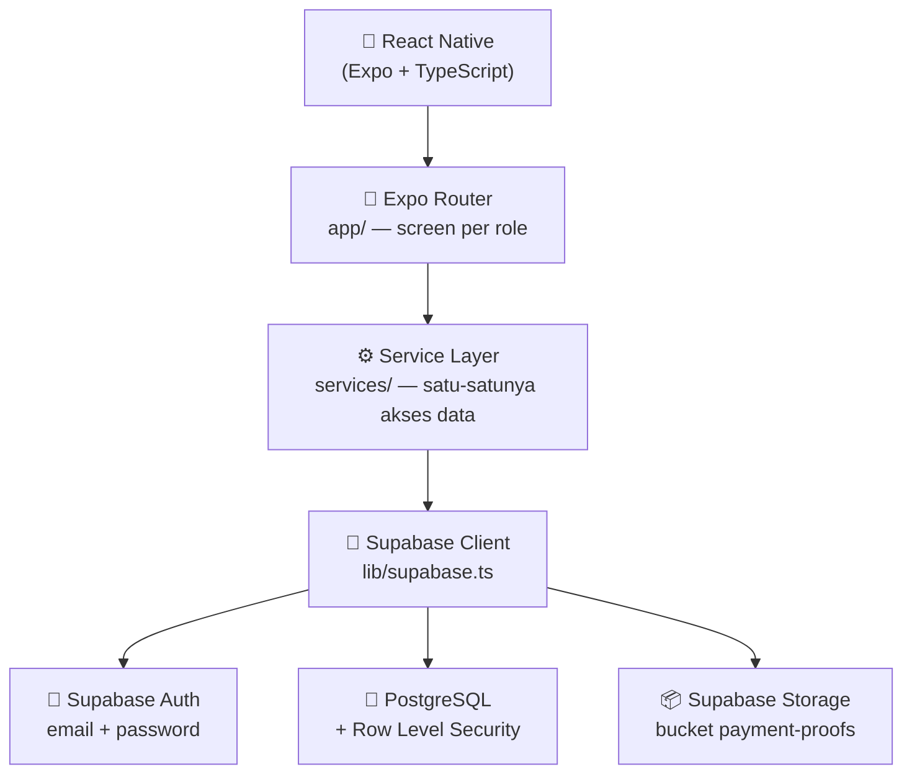
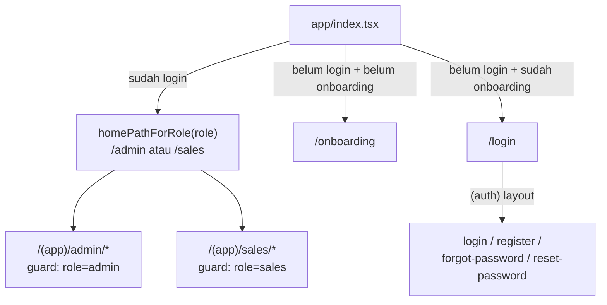
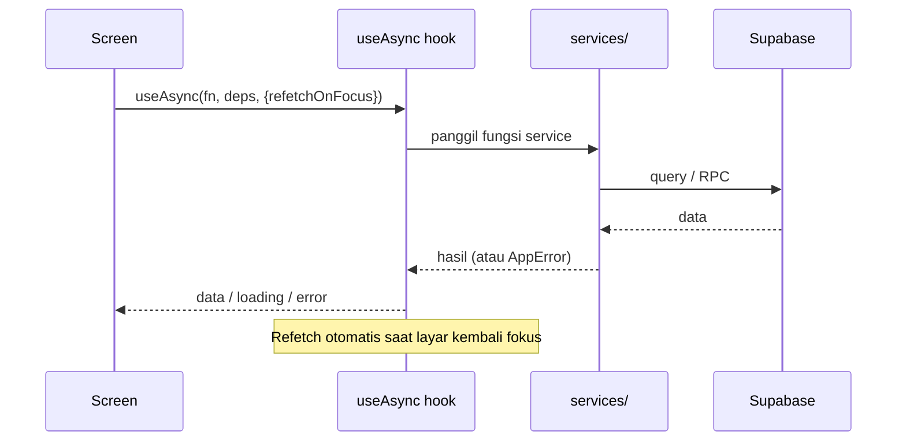
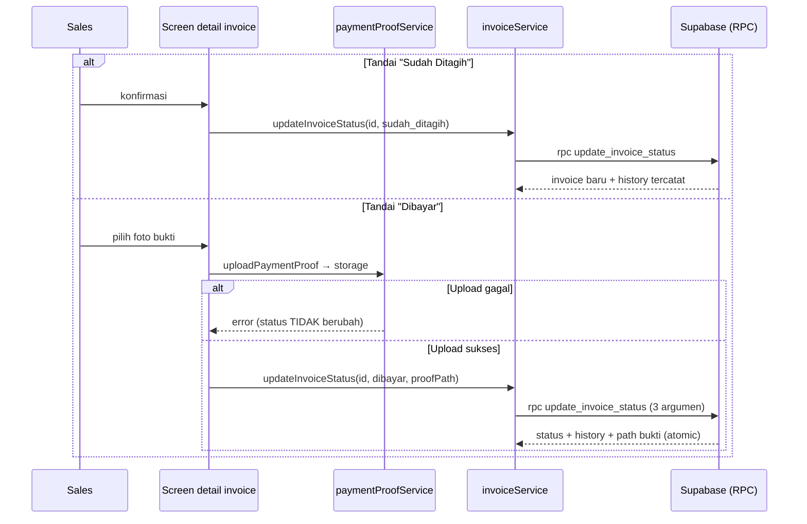

# Arsitektur Aplikasi SalesCollect

Dokumen ini menjelaskan struktur dan alur kerja SalesCollect berdasarkan
implementasi aktual di source code.

## 1. Gambaran Umum

SalesCollect adalah aplikasi mobile (React Native + Expo) yang berbicara
langsung ke Supabase (PostgreSQL, Auth, Storage). Tidak ada backend
Express/Node.js terpisah — seluruh logika data berada di service layer
aplikasi dan aturan keamanan di database (RLS).



Prinsip lapisan:

| Lapisan | Tanggung Jawab |
| --- | --- |
| `app/` (screen) | Render UI, tangani input, navigasi. Tidak query database langsung. |
| `components/` | Komponen UI reusable (form, list, badge, state). |
| `hooks/` | `useAuth` (session/role), `useAsync` (fetch data), `useRouteGuard` (proteksi route). |
| `services/` | Satu-satunya tempat query Supabase. |
| `lib/supabase.ts` | Konfigurasi client Supabase (timeout 15 detik, session storage). |
| Database (RLS) | Sumber kebenaran keamanan: pembatasan akses berbasis role + ownership. |

## 2. Struktur Folder

```text
SalesCollect/
├── app/                    # Route & screen (Expo Router)
│   ├── _layout.tsx         # Root layout: ThemeProvider, AuthProvider, ToastProvider, ErrorBoundary
│   ├── index.tsx           # Entry: redirect berdasarkan session + onboarding flag
│   ├── onboarding.tsx      # Layar perkenalan (sekali saja per device)
│   ├── (auth)/             # Area public: login, register, forgot/reset password
│   └── (app)/              # Area protected (butuh session)
│       ├── _layout.tsx     # Route guard umum + AuthErrorScreen
│       ├── profile.tsx     # Profil semua role (ubah nama, logout)
│       ├── admin/          # Area admin (guard role=admin)
│       │   ├── index.tsx       # Menu utama admin
│       │   ├── dashboard.tsx   # Ringkasan collection
│       │   ├── monitoring.tsx  # Pantau seluruh invoice (search + filter)
│       │   ├── reports.tsx     # Laporan periode + export Excel
│       │   ├── customers/      # list, create, [id] detail, [id] edit
│       │   ├── sales/          # list, create, [id] detail
│       │   └── invoices/       # list, create, [id] detail, [id] edit
│       └── sales/          # Area sales (guard role=sales)
│           ├── index.tsx       # Menu utama sales
│           ├── dashboard.tsx   # Ringkasan invoice miliknya
│           └── invoices/       # list (My Invoices), [id] detail
├── components/             # 29 komponen reusable
├── constants/              # theme.ts (warna/spacing/typography), status.ts
├── hooks/                  # useAuth, useAsync, useRouteGuard
├── lib/                    # supabase.ts (client)
├── services/               # 8 file service layer
├── supabase/migrations/    # 14 file SQL migration (001–014)
├── types/                  # TypeScript types (auth, customer, dashboard, database, invoice, sales, user)
├── utils/                  # currency, date, error, navigation, onboarding, reportExcel, sessionNotice, validation
├── assets/                 # Gambar/icon
├── docs/                   # Dokumentasi project (.md)
├── .env.example            # Template environment variable
├── app.json                # Konfigurasi Expo (scheme: salescollect)
├── eas.json                # Build profile EAS (development, preview, production)
└── package.json
```

## 3. Navigasi

Navigasi memakai **Expo Router** dengan route groups:



Aturan:

- **`app/index.tsx`** — titik masuk: cek session + flag onboarding di AsyncStorage, lalu redirect.
- **Group `(auth)`** — public. Jika user sudah login, `(auth)/_layout` langsung melempar ke area role (kecuali mode reset password).
- **Group `(app)`** — protected. `useRouteGuard()` di `_layout` memastikan session ada.
- **Guard per role** — `admin/_layout.tsx` memakai `useRouteGuard('admin')`, `sales/_layout.tsx` memakai `useRouteGuard('sales')`. Sales yang membuka `/admin/*` akan diarahkan ke `/sales`, dan sebaliknya.
- **Session expired** — jika session hilang tanpa logout, user mendapat pesan "Sesi Anda berakhir" lalu diarahkan ke `/login` (`utils/sessionNotice.ts`).

> Route guard hanya lapisan UX. Keamanan data sesungguhnya di Supabase RLS.

## 4. Pengelolaan Session

- **`hooks/useAuth.tsx`** menyediakan `AuthContext` berisi: `status`, `session`, `user`, `profile`, `role`, `passwordRecovery`, `refreshProfile`, `signOut`.
- Session disimpan oleh Supabase Auth client di **AsyncStorage** (perangkat), dengan `autoRefreshToken: true` (`lib/supabase.ts`).
- Aplikasi tidak pernah menyimpan password atau membuat JWT sendiri.
- Setelah register, trigger database `handle_new_user()` (migration 010) membuat baris `profiles` otomatis dengan role `sales`.
- Flag onboarding (`sc_onboarding_seen`) disimpan di AsyncStorage (`utils/onboarding.ts`).

## 5. Alur Data Utama

### 5.1 Mengambil data (read)



`useAsync` menangani loading, error, proteksi race condition (request lama
tidak menimpa yang terbaru), dan refetch saat layar kembali fokus.

### 5.2 Perubahan status invoice (write)



Urutan penting: **upload bukti dulu → RPC status**. Jika upload gagal, RPC
tidak dipanggil (status tidak berubah). Jika RPC gagal setelah upload,
aplikasi membersihkan file yang baru ter-upload (mencegah file yatim).

### 5.3 Dashboard & laporan

Angka dashboard dan laporan dihitung **di database** melalui fungsi SQL
(`dashboard_summary()`, `collection_report_summary()`,
`collection_report_by_sales()` — migration 012), bukan mengunduh seluruh
invoice ke device. Fungsi memakai `SECURITY INVOKER`, sehingga hasilnya
otomatis mengikuti hak akses RLS pemanggil.

### 5.4 Export laporan

`services/reportExportService.ts` menghasilkan file **.xlsx** (SheetJS)
dari data laporan, lalu dibagikan lewat share sheet bawaan perangkat
(`expo-sharing`). Format PDF/CSV belum didukung.

## 6. Pembagian Tanggung Jawab Komponen

| Kelompok | Contoh | Peran |
| --- | --- | --- |
| Form | `CustomerForm`, `InvoiceForm` | Input + validasi field |
| Selector | `CustomerSelector`, `SalesSelector`, `OptionPicker` | Pilihan data relasi |
| List/Item | `InvoiceListItem`, `DashboardCard`, `DetailRow` | Menampilkan data |
| State | `Loading`, `EmptyState`, `ErrorState`, `AuthErrorScreen` | Feedback proses/data |
| Aksi | `Button`, `ConfirmDialog`, `SearchInput`, `StatusFilterChips`, `DateRangeFilter` | Interaksi pengguna |
| Bukti bayar | `PaymentProofDialog`, `PaymentProofCard` | Upload & tampil bukti |
| Global | `ToastProvider` (sukesan/error), `ErrorBoundary`, `Screen` | Kerangka layar & feedback global |

Aturan di kode:

- Query database hanya lewat `services/`.
- Warna/spacing selalu dari `constants/theme.ts`.
- Pesan error user diambil dari `utils/error.ts` (`getUserMessage`).
- Format uang/tanggal dari `utils/currency.ts` dan `utils/date.ts`.
