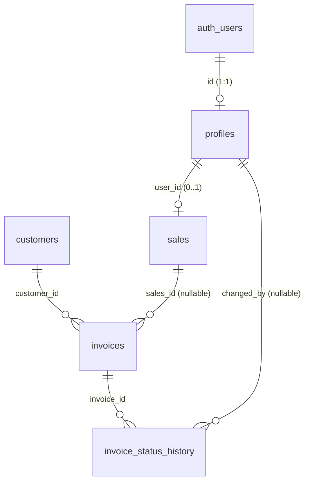

# Database dan State

Dokumen ini menjelaskan struktur database SalesCollect berdasarkan file
migration di `supabase/migrations/` (001–014), serta pengelolaan state
aplikasi. Seluruh isi diverifikasi langsung dari source code.

## 1. Sumber Database

Migration tersusun berurutan dan menjadi satu-satunya sumber skema:

| File | Isi |
| --- | --- |
| `001_enums.sql` | Enum `user_role`, `invoice_status` |
| `002_profiles.sql` | Tabel `profiles` + fungsi `set_updated_at()` |
| `003_sales.sql` | Tabel `sales` |
| `004_customers.sql` | Tabel `customers` |
| `005_invoices.sql` | Tabel `invoices` |
| `006_invoice_status_history.sql` | Tabel `invoice_status_history` |
| `007_indexes.sql` | Index untuk filter/search/ownership |
| `008_constraints.sql` | Unique, check, dan constraint lainnya |
| `009_rls_policies.sql` | Helper function + seluruh kebijakan RLS |
| `010_profile_trigger.sql` | Trigger `handle_new_user()` → profile otomatis |
| `011_status_update_rpc.sql` | RPC `update_invoice_status()` (versi awal, 2 argumen) |
| `012_dashboard_report_functions.sql` | RPC agregasi dashboard & report |
| `013_payment_proof.sql` | Kolom `payment_proof_path`, bucket `payment-proofs`, policies storage |
| `014_payment_proof_rpc.sql` | RPC `update_invoice_status()` versi 3 argumen (dengan bukti bayar) |

## 2. Enum

```sql
public.user_role      = ('admin', 'sales')
public.invoice_status = ('belum_ditagih', 'sudah_ditagih', 'dibayar')
```

Nilai enum dijamin sama dengan tipe TypeScript di `types/user.ts` dan
`types/invoice.ts`.

## 3. Tabel, Kolom, dan Tipe Data

### 3.1 `profiles`

Informasi user aplikasi **selain** credential. Password/token tidak pernah
disimpan di sini.

| Kolom | Tipe | Keterangan |
| --- | --- | --- |
| `id` | uuid | PK, FK → `auth.users(id)` ON DELETE CASCADE |
| `name` | text | NOT NULL, tidak boleh spasi kosong |
| `role` | `user_role` | NOT NULL, default `'sales'` |
| `created_at` | timestamptz | default `now()` |
| `updated_at` | timestamptz | default `now()`, dijaga trigger `set_updated_at()` |

### 3.2 `sales`

| Kolom | Tipe | Keterangan |
| --- | --- | --- |
| `id` | uuid | PK (`gen_random_uuid()`) |
| `user_id` | uuid | FK → `profiles(id)` ON DELETE SET NULL, UNIQUE (satu akun = satu record sales). `NULL` = sales belum punya akun login |
| `name` | text | NOT NULL, tidak boleh spasi kosong |
| `phone` | text | opsional |
| `is_active` | boolean | NOT NULL, default `true`. Sales nonaktif tidak menerima assignment baru; data historis tetap ada |
| `created_at` / `updated_at` | timestamptz | dengan trigger `updated_at` |

### 3.3 `customers`

| Kolom | Tipe | Keterangan |
| --- | --- | --- |
| `id` | uuid | PK |
| `name` | text | NOT NULL, tidak boleh spasi kosong (satu-satunya field wajib) |
| `owner_name` | text | opsional |
| `phone` | text | opsional |
| `address` | text | opsional |
| `created_at` / `updated_at` | timestamptz | dengan trigger `updated_at` |

### 3.4 `invoices`

| Kolom | Tipe | Keterangan |
| --- | --- | --- |
| `id` | uuid | PK |
| `invoice_number` | text | NOT NULL, UNIQUE, tidak boleh spasi kosong |
| `customer_id` | uuid | NOT NULL, FK → `customers(id)` ON DELETE RESTRICT |
| `sales_id` | uuid | nullable, FK → `sales(id)` ON DELETE RESTRICT. `NULL` = invoice belum ditugaskan |
| `amount` | numeric(18,2) | NOT NULL, CHECK `>= 0` |
| `invoice_date` | date | NOT NULL |
| `due_date` | date | NOT NULL, CHECK `>= invoice_date` |
| `status` | `invoice_status` | NOT NULL, default `'belum_ditagih'` |
| `notes` | text | opsional |
| `payment_proof_path` | text | opsional; path file bukti bayar di bucket private (dari migration 013). `NULL` = belum ada bukti |
| `created_at` / `updated_at` | timestamptz | dengan trigger `updated_at` |

Catatan ON DELETE:

- `customer_id` RESTRICT — customer dengan invoice aktif tidak bisa dihapus
  (aplikasi juga mengecek ini sebelum menghapus, lihat `countInvoicesByCustomerId`).
- `sales_id` RESTRICT — invoice tidak kehilangan pemilik tanggung jawab;
  penonaktifan sales dilakukan lewat `is_active`, bukan delete.

### 3.5 `invoice_status_history`

| Kolom | Tipe | Keterangan |
| --- | --- | --- |
| `id` | uuid | PK |
| `invoice_id` | uuid | NOT NULL, FK → `invoices(id)` ON DELETE CASCADE |
| `old_status` | `invoice_status` | nullable (NULL untuk perubahan pertama) |
| `new_status` | `invoice_status` | NOT NULL |
| `changed_by` | uuid | FK → `profiles(id)` ON DELETE SET NULL (hapus akun tidak menghapus jejak) |
| `changed_at` | timestamptz | default `now()` |

Baris history **hanya** ditulis oleh fungsi database `update_invoice_status`
(RPC). Klien tidak memiliki policy INSERT/UPDATE/DELETE di tabel ini.

## 4. Relasi



Skema teks:

```text
auth.users
   │
   └── profiles (id, name, role, created_at, updated_at)
         │
         └── sales (id, user_id, name, phone, is_active, ...)
               │
               └── invoices (id, invoice_number, customer_id, sales_id,
                             amount, invoice_date, due_date, status,
                             notes, payment_proof_path)
                     │
                     ├── customers (id, name, owner_name, phone, address)
                     │
                     └── invoice_status_history (id, invoice_id, old_status,
                                                 new_status, changed_by, changed_at)
```

## 5. Status Invoice

Status collection hanya memiliki tiga nilai dengan transisi **linear**:

```text
belum_ditagih  →  sudah_ditagih  →  dibayar
```

Aturan (ditegakkan di aplikasi `invoiceService.updateInvoiceStatus` DAN di
RPC database `update_invoice_status`, migration 011/014):

- Mundur, melompat status, atau status sama → ditolak dengan pesan error.
- Setiap perubahan menulis satu baris `invoice_status_history` dalam
  transaksi yang sama (atomic).
- Transisi ke `dibayar` **wajib** menyertakan bukti pembayaran
  (`payment_proof_path`); path diunggah ke storage sebelum RPC dipanggil.
- Status awal invoice baru selalu `belum_ditagih` (default kolom).

## 6. Index (migration 007)

| Index | Tabel | Kolom | Kegunaan |
| --- | --- | --- | --- |
| `idx_profiles_role` | profiles | `role` | lookup role (dipakai helper RLS) |
| `idx_sales_user_id` | sales | `user_id` | ownership: login → record sales |
| `idx_sales_is_active` | sales | `is_active` | filter sales aktif |
| `idx_invoices_customer_id` | invoices | `customer_id` | relasi invoice → customer |
| `idx_invoices_sales_id` | invoices | `sales_id` | ownership invoice |
| `idx_invoices_status` | invoices | `status` | filter status |
| `idx_invoices_due_date` | invoices | `due_date` | urutan jatuh tempo |
| `idx_invoice_status_history_invoice_id` | invoice_status_history | `invoice_id` | riwayat per invoice |
| `idx_invoice_status_history_changed_by` | invoice_status_history | `changed_by` | riwayat per user |

`invoice_number` tidak perlu index tambahan karena unique constraint sudah
membuat index uniknya sendiri.

## 7. Constraint (migration 008)

| Constraint | Tabel | Aturan |
| --- | --- | --- |
| `invoices_invoice_number_key` | invoices | `invoice_number` unik |
| `invoices_invoice_number_not_blank` | invoices | `invoice_number` tidak hanya spasi |
| `invoices_amount_check` | invoices | `amount >= 0` |
| `invoices_due_date_check` | invoices | `due_date >= invoice_date` |
| `sales_user_id_key` | sales | satu `user_id` hanya terhubung ke satu sales |
| `profiles_name_not_blank` | profiles | `name` tidak kosong |
| `sales_name_not_blank` | sales | `name` tidak kosong |
| `customers_name_not_blank` | customers | `name` tidak kosong |

Tipe enum sudah menjamin isi `role` dan `status`; FK dan NOT NULL sudah
didefinisikan di migration masing-masing tabel.

## 8. Storage (Bukti Pembayaran)

Migration 013 membuat:

- Bucket **private** `payment-proofs`
  - `file_size_limit`: 5 MB (5242880 byte)
  - `allowed_mime_types`: `image/jpeg`, `image/png`, `image/webp`, `image/heic`, `image/heif`
- Struktur path: `invoices/{invoice_id}/{nama_unik}.{ext}`
- Policies storage: INSERT/UPDATE/DELETE hanya sales pemilik invoice;
  SELECT sales pemilik atau admin (dicek lewat join `invoices` → `sales`
  di dalam policy, bukan hanya UI).
- URL ditampilkan lewat **signed URL** (`paymentProofService.getPaymentProofUrl`).

## 9. Fungsi Database (RPC)

| Fungsi | Argumen | Keamanan | Fungsi |
| --- | --- | --- | --- |
| `update_invoice_status(uuid, invoice_status, text default null)` | invoice, status baru, path bukti (opsional) | `SECURITY DEFINER` + cek `can_access_invoice()`, revoke dari `anon` | Ubah status + tulis history atomic |
| `dashboard_summary()` | – | `SECURITY INVOKER`, hanya `authenticated` | Ringkasan dashboard (count per status + total nominal) |
| `collection_report_summary(date, date)` | periode (`invoice_date`) | `SECURITY INVOKER`, hanya `authenticated` | Rekap laporan per periode |
| `collection_report_by_sales(date, date)` | periode | `SECURITY INVOKER`, hanya `authenticated` | Rincian per sales (urut nama, `sales_id` NULL = "Belum ditugaskan") |

Catatan migration 014 menggantikan definisi fungsi dari migration 011
menjadi versi 3 argumen; pemanggilan lama dengan 2 argumen tetap valid
(karena argumen ketiga punya default `NULL`).

## 10. Pengelolaan State Aplikasi

Aplikasi tidak memakai library state management eksternal (Redux, Zustand,
dst.). Yang dipakai:

| Jenis State | Lokasi | Detail |
| --- | --- | --- |
| Session & role (global) | `hooks/useAuth.tsx` (React Context) | `status`, `session`, `user`, `profile`, `role`, `passwordRecovery` — dibaca semua screen via `useAuth()` |
| Toast (global) | `components/ToastProvider.tsx` (React Context) | `toast.success/error/info` |
| Data per layar | `hooks/useAsync.ts` | `data`, `loading`, `error`, `reload`; refetch saat layar kembali fokus; proteksi race condition |
| Form per layar | `useState` lokal di screen | Input form, error validasi, flag dialog |
| Persist lokal | AsyncStorage | Session Supabase (auto refresh), flag onboarding `sc_onboarding_seen` |
| Server state | Supabase PostgreSQL | Sumber kebenaran tunggal; tidak ada cache lokal — diambil ulang saat layar fokus |

Session Supabase disimpan di AsyncStorage melalui konfigurasi di
`lib/supabase.ts` (`persistSession: true`, `autoRefreshToken: true`),
dengan `fetch` timeout 15 detik agar request yang menggantung tidak
selamanya menunggu.
