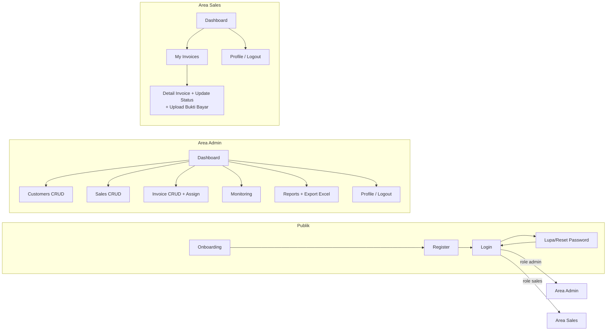
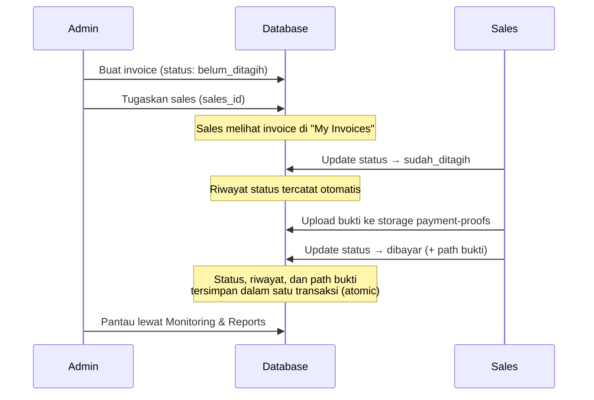

# Use Case dan Alur Pengguna

Dokumen ini mendeskripsikan use case SalesCollect berdasarkan screen dan
service yang benar-benar ada di source code (route di `app/`, aksi di
`services/`).

## 1. Gambaran Besar



## 2. Use Case Bersama (Semua Pengguna)

| ID | Use Case | Aktor | Alur Ringkas | Catatan |
| --- | --- | --- | --- | --- |
| UC-01 | Melihat onboarding | Pengguna baru | Buka app → layar perkenalan → lanjut ke Login | Sekali saja per device (flag AsyncStorage) |
| UC-02 | Register | Pengguna baru | Isi nama, email, password, konfirmasi → validasi → akun dibuat | Role otomatis `sales`; admin menaikkan role manual |
| UC-03 | Login | Admin / Sales | Isi email + password → diverifikasi Supabase Auth → redirect sesuai role | Session disimpan di perangkat |
| UC-04 | Lupa password | Pengguna | Masukkan email → terima link reset → buat password baru | Link memakai redirect URL terdaftar |
| UC-05 | Reset password via link | Pengguna | Buka link dari email → mode recovery → simpan password baru | Selama recovery, user tetap di area auth |
| UC-06 | Lihat / ubah profil | Admin / Sales | Menu Profile → lihat nama & role → ubah nama (opsional) → Simpan | Role tidak bisa diubah dari layar ini |
| UC-07 | Logout | Admin / Sales | Menu Logout → konfirmasi → session dihapus → ke Login | |

## 3. Use Case Admin

Menu utama admin (`app/(app)/admin/index.tsx`): Dashboard, Customers,
Sales, Invoices, Monitoring, Reports, Profile, Logout.

| ID | Use Case | Alur (berdasarkan screen) | Aturan |
| --- | --- | --- | --- |
| UC-A01 | Dashboard collection | Buka Dashboard → kartu ringkasan: total invoice, belum/sudah ditagih, dibayar, total nominal | Dihitung fungsi `dashboard_summary()` di database |
| UC-A02 | Daftar customer | Customers → daftar (nama, telepon) → tap untuk detail | Empty state bila belum ada data |
| UC-A03 | Tambah customer | Customers → Tambah → isi nama (wajib), nama pemilik, telepon, alamat → Simpan | Validasi form; muncul di daftar setelah tersimpan |
| UC-A04 | Detail customer | Tap customer → info + daftar invoice terkait + jumlah invoice | Invoice bisa dibuka dari daftar |
| UC-A05 | Edit customer | Detail → Edit → ubah data → Simpan | Perubahan langsung tersimpan |
| UC-A06 | Hapus customer | Detail → Hapus → konfirmasi → terhapus | **Ditolak** jika customer masih punya invoice |
| UC-A07 | Daftar sales | Sales → daftar (nama, telepon, status aktif) | Sales nonaktif tetap tampil di detail |
| UC-A08 | Tambah sales | Sales → Tambah → isi nama, telepon, (opsional) tautkan akun login → Simpan | Sales baru tersedia untuk assignment |
| UC-A09 | Detail sales | Tap sales → info + invoice yang ditugaskan (dengan status) | Riwayat tugas penagihan per sales |
| UC-A10 | Aktif/nonaktifkan sales | Detail sales → ubah status aktif | Sales nonaktif tidak menerima assignment baru |
| UC-A11 | Daftar invoice | Invoices → daftar: nomor, customer, sales, nominal, jatuh tempo, status | |
| UC-A12 | Cari invoice | Ketik di kolom cari → cocok nomor invoice / nama customer | Debounce pencarian |
| UC-A13 | Filter invoice | Chips status: Semua / Belum Ditagih / Sudah Ditagih / Dibayar | Bisa digabung dengan pencarian |
| UC-A14 | Tambah invoice | Invoices → Tambah → isi nomor, customer, nominal, tanggal, jatuh tempo, sales (opsional), catatan → Simpan | Status awal otomatis **Belum Ditagih** |
| UC-A15 | Detail invoice | Tap invoice → semua field + customer + riwayat status + bukti bayar (jika ada) | |
| UC-A16 | Edit invoice | Detail → Edit → ubah data → Simpan | Divalidasi sebelum tersimpan |
| UC-A17 | Tugaskan / alihkan sales | Detail → pilih sales lain → simpan assignment | Hanya admin; sales tidak bisa memindahkan miliknya |
| UC-A18 | Hapus invoice | Detail → Hapus → konfirmasi → terhapus | Invoice beserta riwayat statusnya ikut terhapus |
| UC-A19 | Monitoring collection | Monitoring → cari + filter status → lihat kondisi invoice | Tampilan pemantauan tanpa aksi ubah |
| UC-A20 | Laporan periode | Reports → pilih rentang tanggal → ringkasan: total invoice & nominal, jumlah per status | Dihitung fungsi `collection_report_summary()` |
| UC-A21 | Laporan per sales | Reports → bagian per sales: jumlah invoice & status tiap sales | `sales_id` kosong tampil "Belum ditugaskan"; urut nama (tanpa ranking) |
| UC-A22 | Export laporan | Reports → Export → file `.xlsx` dibuat → dibagikan via share sheet | Format lain (PDF/CSV) belum didukung |

Catatan: pembaruan status invoice di UI dilakukan oleh **Sales** (UC-S03).
Database juga mengizinkan admin lewat RPC, tetapi layar admin saat ini
tidak menyediakan tombol pembaruan status — admin memantau lewat riwayat
dan laporan.

## 4. Use Case Sales

Menu utama sales (`app/(app)/sales/index.tsx`): Dashboard, My Invoices,
Profile, Logout.

| ID | Use Case | Alur (berdasarkan screen) | Aturan |
| --- | --- | --- | --- |
| UC-S01 | Dashboard sales | Buka Dashboard → ringkasan invoice milik sendiri: total, belum/sudah ditagih, dibayar | Hanya invoice yang ditugaskan kepadanya |
| UC-S02 | Daftar My Invoices | My Invoices → daftar invoice miliknya (customer, nominal, jatuh tempo, status) | Invoice sales lain tidak pernah muncul; belum ada kolom cari/filter di layar ini |
| UC-S03 | Perbarui status penagihan | Detail invoice → Perbarui Status → konfirmasi transisi → status tersimpan | Hanya `Belum Ditagih → Sudah Ditagih → Dibayar`; mundur/lompat/sama ditolak |
| UC-S04 | Tandai Dibayar (dengan bukti) | Detail → Tandai Dibayar → pilih/ambil foto bukti → upload → status menjadi Dibayar | Bukti **wajib**; upload gagal → status tidak berubah; RPC gagal → file upload dibersihkan |
| UC-S05 | Lihat detail invoice + customer | Detail invoice → info tagihan + nama/telepon/alamat customer | Customer hanya yang terkait invoice miliknya |
| UC-S06 | Lihat riwayat status | Detail invoice → bagian riwayat (status lama → baru, pengubah, waktu) | Data dari tabel `invoice_status_history` |
| UC-S07 | Lihat bukti bayar | Detail invoice → kartu bukti (milik sendiri, atau milik invoice yang diakses) | URL via signed URL |

Yang **tidak** bisa dilakukan sales (ditegakkan RLS, bukan hanya UI):

- Membuat, mengedit, menghapus, atau memindahkan invoice ke sales lain.
- Melihat atau mengubah invoice sales lain.
- Mengelola data customer/sales (CRUD admin).

## 5. Alur Utama End-to-End

### 5.1 Alur penagihan (dari invoice sampai dibayar)



### 5.2 Alur admin membangun data

1. Admin menambahkan **customer** (UC-A03).
2. Admin menambahkan **sales** (UC-A08) — opsional menautkan akun login sales.
3. Admin membuat **invoice** dan menugaskannya ke sales (UC-A14, UC-A17).
4. Sales menjalankan penagihan (bagian 5.1).
5. Admin memantau lewat **Dashboard**, **Monitoring**, dan **Reports**
   (UC-A01, UC-A19–A22), termasuk export Excel.

### 5.3 Proteksi antar-role

```mermaid
flowchart TD
    LOGIN[Login] --> G{useRouteGuard}
    G -->|role admin, buka /sales/*| RA[Redirect ke /admin]
    G -->|role sales, buka /admin/*| RS[Redirect ke /sales]
    G -->|session habis| L[Pesan "Sesi Anda berakhir" → /login]
    G -->|sesuai| OK[Layar dirender]
    OK -.->|hanya UX| RLS[RLS tetap menolak akses data liar]
```
